# PolicyPulse — AI-Powered Public Opinion Analytics Platform

> A multilingual NLP analytics portal that collects, analyzes, and visualizes public opinion on Pakistani **health and education policies**, turning scattered YouTube comments and news articles into role-based, decision-ready dashboards.

**Final Year Project** · Bachelor of Science in Data Science, COMSATS University Islamabad (2022–2026)
**Team:** Fiza Fatima, Hafsa Nadeem · **Supervisor:** Ms. Maheen Gul

<!-- MY ROLE: add 3-5 honest bullets here about what YOU personally built, e.g. "Built the multilingual preprocessing pipeline", "Designed the PostgreSQL schema", "Implemented the Streamlit pages X and Y". -->

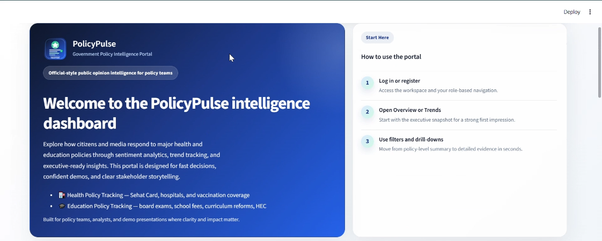

---

## The Problem

Public opinion on government policies is scattered across news sites and social media in Urdu, Roman Urdu, and English. Traditional reports are static and numeric, so policymakers and researchers struggle to see what citizens actually think. PolicyPulse ("mirror" in Urdu) reflects that sentiment in one place.

## What It Does

- **Collects** real public opinion data automatically from the YouTube Data API v3 and Pakistani news feeds (Dawn, Geo, Express Tribune, ARY, The News, Pakistan Today).
- **Processes** multilingual text (Urdu script, Roman Urdu, English, and mixed code-switched text) with a custom NLP pipeline.
- **Classifies** sentiment (positive / negative / neutral) with confidence scores.
- **Visualizes** results in an interactive multi-page dashboard with role-based access.
- **Answers questions** through an AI chatbot grounded in the live data.
- **Automates** the whole pipeline end to end on a schedule.

## Data

| Source | Records | Coverage |
|---|---|---|
| YouTube comments (Health) | ~4,800 | Sehat Card, Hospital Services, Vaccination Campaigns |
| YouTube comments (Education) | ~1,300 | Board Exams, School Fees, Education Access, Education Policy, Higher Education |
| News articles | 900+ | RSS feeds from 6 Pakistani outlets |
| Expert opinions | curated seed set | All 8 policies |

In total the platform holds **6,100+ YouTube comments and 900+ news articles** across **8 policy themes**, each tagged with policy, region, source, and timeline metadata.

## Key Features

### Multilingual NLP pipeline
- Custom **language detector** for Urdu script (Unicode range check), Roman Urdu (curated keyword list), English, and mixed text.
- Text normalization: HTML/URL/mention removal, hashtag word preservation, repeated-character collapsing, emoji preservation, Roman Urdu standardization, Urdu transliteration, and tokenization.

### Sentiment analysis
- Multilingual **keyword-based classifier** (English, Urdu script, Roman Urdu) with scaled confidence scores, used as the production classifier.
- **XLM-RoBERTa** (`cardiffnlp/twitter-xlm-roberta-base-sentiment`) inference module with automatic fallback to the keyword classifier, plus a fine-tuning script ready for domain-specific training.
- Live **Sentiment Explorer** to test any text and see the detected language and confidence.

### Dashboard (Streamlit)
- **Seven analysis pages:** Overview, Sentiment Analysis, Citizen vs Media, Data Explorer, Trends & Forecasting, Deep Insights, Expert Opinions.
- Charts including donut charts, trend lines, heatmaps, sunburst/treemap views, radar charts, bubble charts, and word clouds.
- **ETS trend forecasting** with an uncertainty band.
- Political impact analysis (party-wise sentiment) and citizen vs media comparison.
- Filtering by policy, region, date range, and language; **CSV and PDF export**.

### AI chatbot
- Understands natural-language questions, interpreting the **policy, domain, and timeframe** (with spelling correction).
- **Hybrid retrieval** (TF-IDF cosine similarity + BM25) over live dashboard statistics.
- Role-adaptive answers for Admin, Analyst, and General User audiences.

### Security & administration
- **FastAPI** REST backend with **JWT** authentication.
- **bcrypt** password hashing, 5-attempt account lockout, time-limited single-use password-reset tokens.
- **Role-Based Access Control** for 3 roles (Admin, Analyst, General User) enforced at routing and page level.
- **Audit logging** of user actions, plus an **Admin Panel** for user management and data-health monitoring.

### Automation
- A single workflow (collect → preprocess → sentiment → load to database → cache refresh → health check) orchestrated with Python `subprocess` and **APScheduler**, with per-step status logging and automated data-health validation.

## Architecture

```
YouTube API / News RSS
        │
        ▼
 Collection scripts ──► Preprocessing (language detection, cleaning)
                                   │
                                   ▼
                        Sentiment classification
                                   │
                                   ▼
          PostgreSQL (SQLAlchemy ORM) ◄──► FastAPI (JWT auth, REST endpoints)
                                   │
                                   ▼
              Streamlit dashboard + chatbot (RBAC, audit logs)
```

## Screenshots

### Sentiment analysis & trends

| Sentiment analysis | Sentiment trend over time |
|---|---|
| 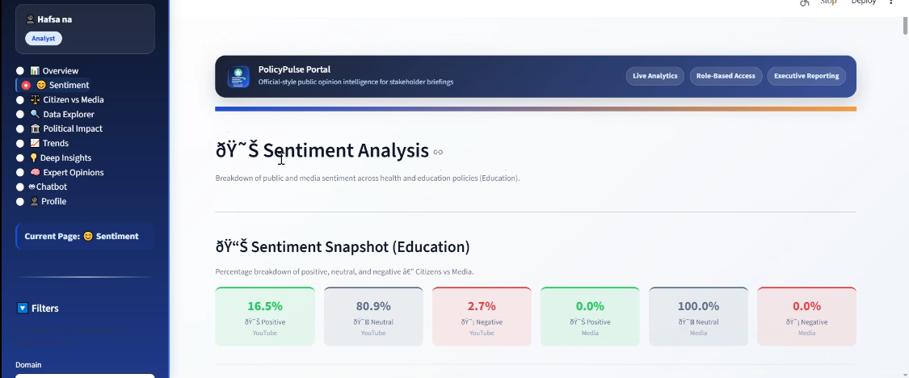 | 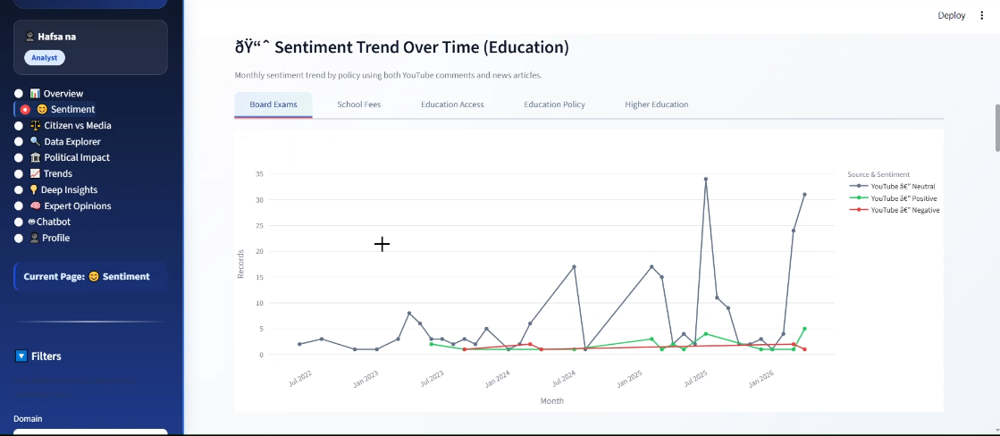 |

| Language breakdown | Policy × month heatmap |
|---|---|
| 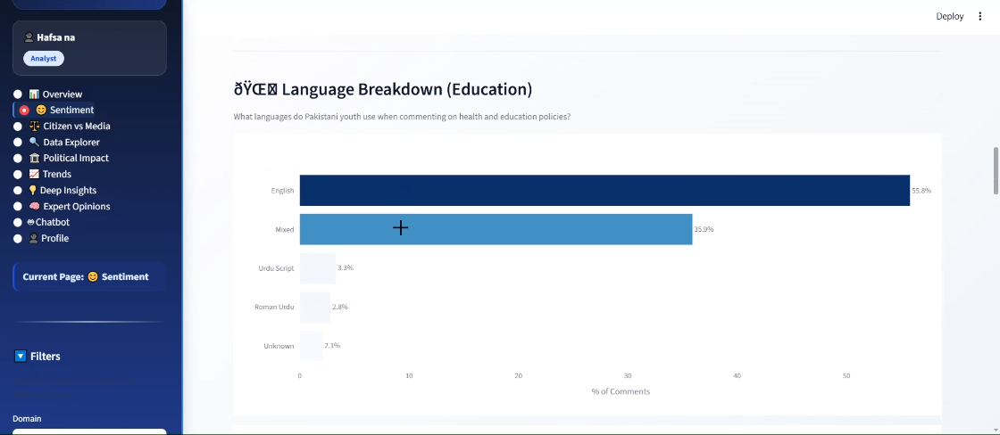 | 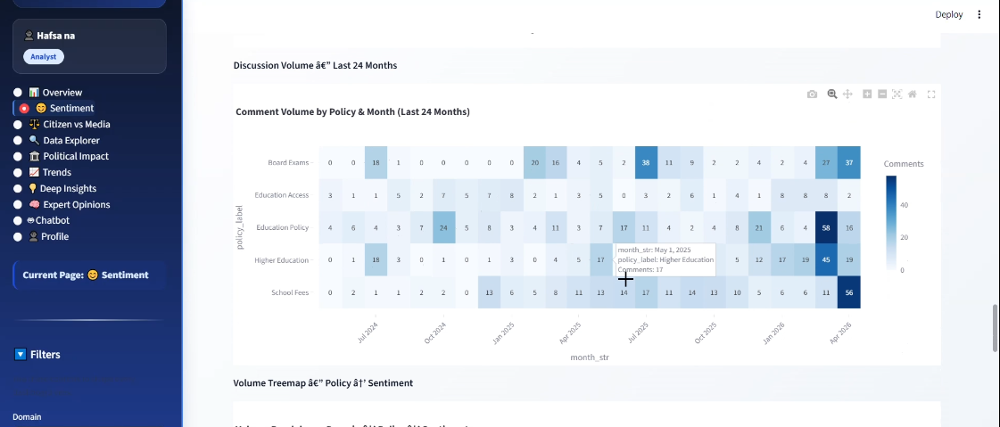 |

### Live sentiment explorer

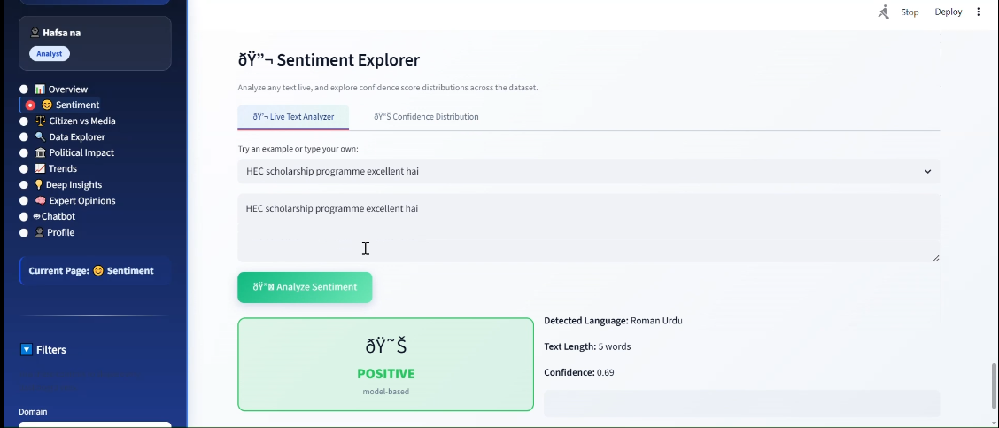

### Citizen vs media, deep insights, and politics

| Citizen vs Media | Policy radar |
|---|---|
| 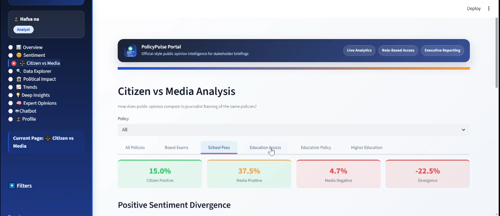 | 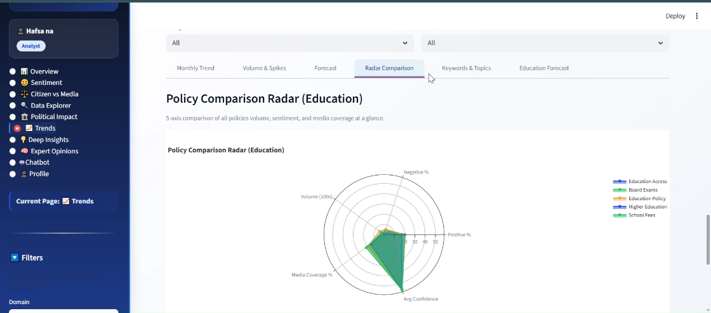 |

| Deep insights | Political party sentiment |
|---|---|
| 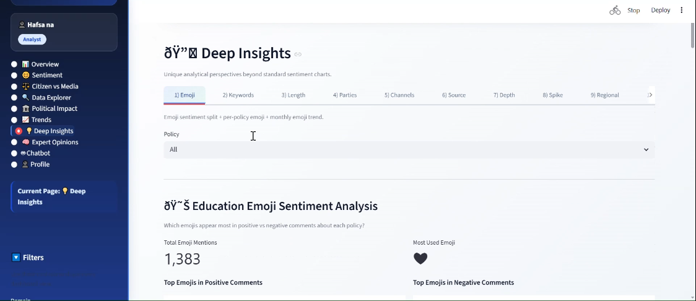 | 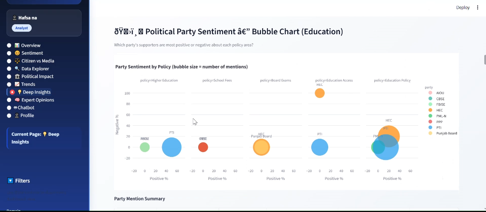 |

| Sentiment bubble chart | Expert opinions |
|---|---|
| 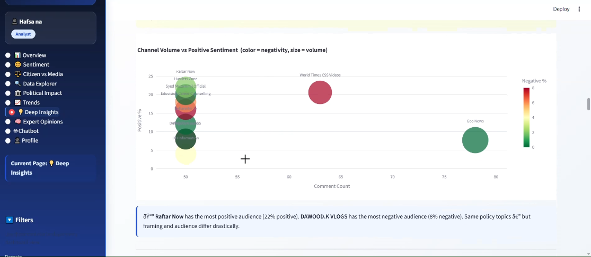 | 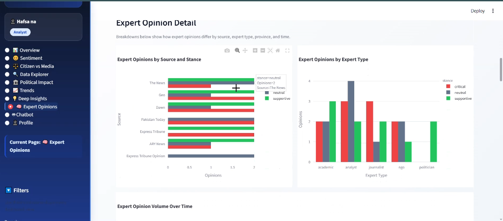 |

### Chatbot, data explorer, and admin

| AI chatbot | Data explorer |
|---|---|
| 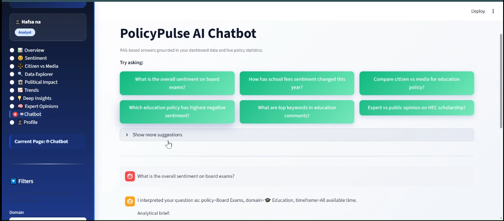 | 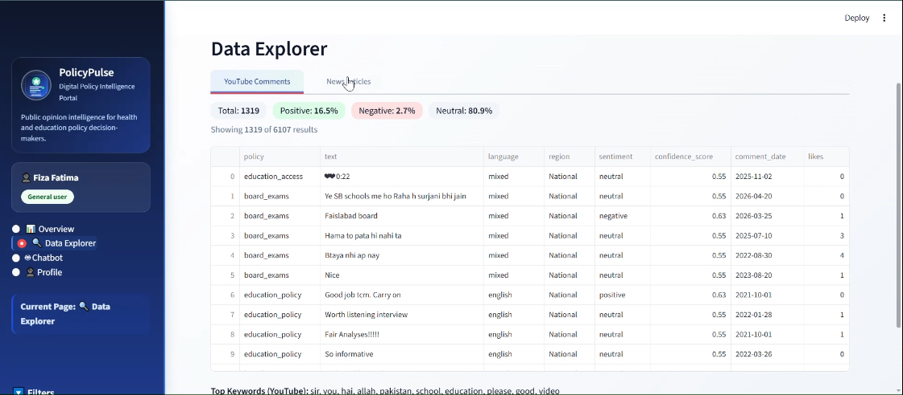 |

| Login | Admin panel |
|---|---|
| 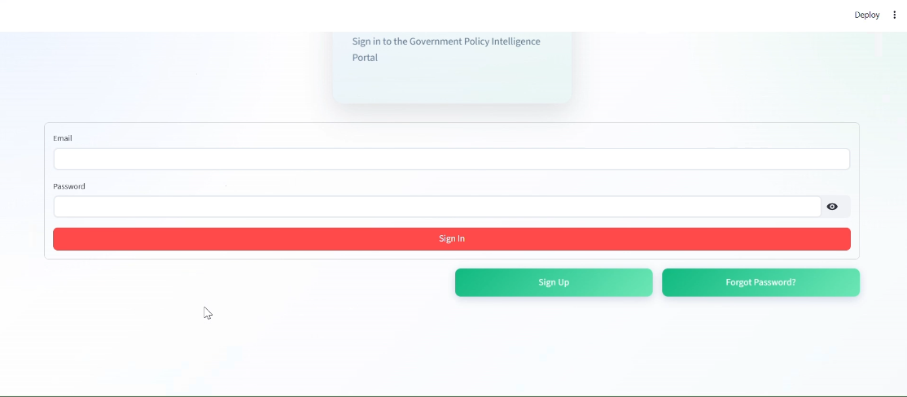 | 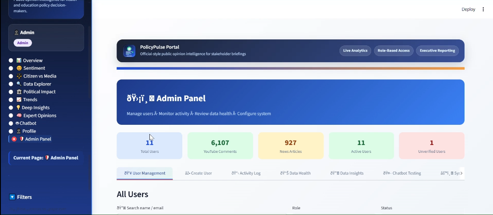 |

## Testing

The system was tested at four levels, documented in the project report:
- **Unit tests** for role-based navigation, preprocessing, authentication, sentiment inference, NLP utilities, and the chatbot retrieval pipeline.
- **Functional tests** of the dashboard pages and user workflows.
- **Business-rule tests** for role access and policy actions.
- **Integration tests** of the API endpoints (`/sentiment-stats`, `/latest`, `/search`, `/register`, `/login`) and the full pipeline from raw data to dashboard.

## Limitations & Future Work

Being upfront about what comes next:
- Fine-tune XLM-RoBERTa on labeled Pakistani health and education comments to replace the keyword classifier and improve Roman Urdu and code-switched accuracy.
- Add sarcasm detection.
- Deploy to the cloud with Docker and a managed PostgreSQL database (currently runs as a local deployment).
- Add real-time ingestion, an annotation feedback loop, and Urdu-language PDF reports.

## Tech Stack

Python · FastAPI · Streamlit · PostgreSQL · SQLAlchemy · XLM-RoBERTa · HuggingFace Transformers · PyTorch · scikit-learn · Plotly · pandas · statsmodels · BeautifulSoup · bcrypt · JWT · APScheduler · YouTube Data API v3

## Source Code

The source code for this project is not publicly available. The full project report (111 pages) is available on request.

[⬅ Back to Portfolio](../../README.md)
